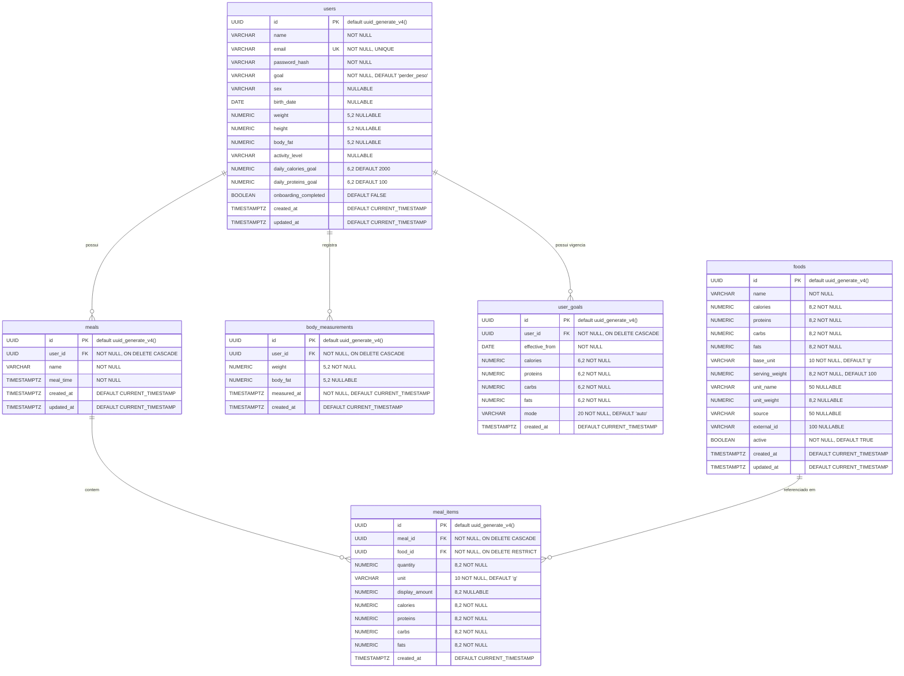

# Arquitetura do Sistema (ARCHITECTURE.md)

Este documento detalha o desenho arquitetural, o modelo relacional de dados, as camadas de software e as decisões técnicas implementadas no **CalorieSync**.

---

## 1. Visão Geral e Camadas [CONFIRMADO]

O projeto é estruturado em um monorepo com separação estrita entre o cliente SPA e o servidor de API:

```
[Cliente Web (React 19 + Vite)]
         │
         ▼  (HTTP REST / JSON - Authorization: Bearer <JWT>)
[Middlewares (CORS, Helmet, Rate-Limit, Auth JWT, Zod Validate)]
         │
         ▼
[Controllers (Express - Parse HTTP & Resposta Padronizada)]
         │
         ▼
[Services (Regras de Negócio Puras, TMB, Transações)]
         │
         ▼
[Models (SQL Puro via pg.Pool - Parametrizado)]
         │
         ▼
[(PostgreSQL 14+ com pg_trgm e unaccent)]
```

### Camadas do Backend (`/backend/src/`) [CONFIRMADO]
1. **`routes/`**: Declaração dos endpoints e associação com middlewares específicos (`authMiddleware`, `validate(schema)`).
2. **`controllers/`**: Extração de dados da requisição (`req.body`, `req.params`, `req.query`, `req.userId`), invocação do service correspondente e devolução de resposta formatada no padrão `{ success, data, message }`. Não contém lógica de negócio.
3. **`services/`**: Lógica de aplicação, cálculos matemáticos (TMB/TDEE), coordenação de persistência e validações de integridade de regras.
4. **`models/`**: Consultas diretas ao PostgreSQL via driver nativo `pg.Pool`, com parametrização estrita de valores contra SQL Injection.
5. **`middlewares/`**:
   - `auth.ts`: Validação de tokens JWT e extração de `userId`.
   - `validate.ts`: Middleware genérico para validação de esquemas Zod (body, params, query) retornando 400 em caso de falha.
   - `errorHandler.ts`: Captura global de exceções não tratadas com resposta 500 sem vazamento de stack traces.

### Camadas do Frontend (`/frontend/src/`) [CONFIRMADO]
1. **`services/api.ts` (`apiFetch`)**: Wrapper centralizado de `fetch` que injeta o token Bearer do `localStorage` e limpa a sessão em caso de 401.
2. **TanStack Query (React Query v5)**: Gerencia chamadas assíncronas, estado de cache, revalidação e flags de loading/error.
3. **`context/AuthContext.tsx`**: Estado global da sessão do usuário autenticado.
4. **`components/` & `pages/`**: Componentes estilizados com Tailwind CSS em estética brutalista (`rounded-none`, bordas contrastantes) e modais acessíveis via Radix UI com focus trap.

---

## 2. Diagrama Entidade-Relacionamento (ER) [CONFIRMADO]

O esquema do banco de dados é composto por **6 tabelas**, geradas pelas migrações em `backend/migrations/`:



### Índices e Constraints Críticas [CONFIRMADO]
- `foods`:
  - `foods_source_external_id_key`: Constraint de unicidade composta `UNIQUE (source, external_id)`.
  - `idx_foods_name_trgm`: Índice GIN de similaridade trigram: `CREATE INDEX idx_foods_name_trgm ON foods USING GIN (f_unaccent(name) gin_trgm_ops)`.
- `meals`:
  - `idx_meals_user_id_meal_time`: Índice composto `ON meals(user_id, meal_time DESC)` para aceleração de buscas no dashboard diário.
- `meal_items`:
  - `idx_meal_items_meal_id`: Índice simples `ON meal_items(meal_id)`.
- `body_measurements`:
  - Índice composto `ON body_measurements(user_id, measured_at)`.
- `user_goals`:
  - `unique_user_goal_per_day`: Constraint de unicidade `UNIQUE (user_id, effective_from)`, garantindo uma única meta vigente por data para cada usuário.

---

## 3. Decisões Técnicas com Justificativa [CONFIRMADO]

| Decisão | Escolha | Justificativa |
| :--- | :--- | :--- |
| **Acesso a Dados** | Driver nativo `pg` (sem ORM) | Elimina a sobrecarga e abstração de ORMs (Prisma, Sequelize), permitindo consultas analíticas com SQL puro (CTEs, `LATERAL JOIN`, extensões de trigram). |
| **Migrações** | `node-pg-migrate` | Gerenciamento determinístico de alterações de esquema em arquivos JS/SQL versionados no Git, sem estado embutido obscuro. |
| **Denormalização Nutricional** | Macros gravados em `meal_items` | Quando uma refeição é criada, as calorias e macronutrientes da porção são calculados e persistidos diretamente no registro do item. Se os dados do alimento base forem alterados ou removidos futuramente, o registro histórico do que o usuário efetivamente consumiu naquele dia permanece íntegro e imutável. |
| **Transações Atômicas** | `BEGIN` / `COMMIT` / `ROLLBACK` | Operações de gravação que tocam `meals` e múltiplos `meal_items` (criação e atualização) executam obrigatoriamente dentro de transações de banco para evitar registros órfãos. |
| **Validação Universal** | Zod em todo o pipeline | O Zod é usado para validar variáveis de ambiente na inicialização (fail-fast), parâmetros HTTP nos middlewares do backend e entradas de formulários no frontend. |
| **Catálogo Protegido** | `foods` somente-leitura para usuários | Usuários comuns não possuem endpoints para cadastrar, editar ou apagar alimentos globais, evitando corrupção do catálogo. A inserção é restrita a migrações e scripts de carga (`import-foods.ts`). |

---

## 4. Tratamento de Fuso Horário e Datas [CONFIRMADO]

1. **Definição de Fuso no Node.js:**
   - Todos os scripts de execução no `backend/package.json` (`dev`, `test`, `start`) injetam obrigatoriamente:
     `cross-env TZ=America/Sao_Paulo`
2. **Armazenamento no Banco de Dados:**
   - Colunas de momento temporal (`created_at`, `updated_at`, `meal_time`, `measured_at`) são tipadas como `TIMESTAMP WITH TIME ZONE` (`TIMESTAMPTZ`), garantindo persistência em UTC com preservação de offset.
   - Colunas puramente de data civil (`birth_date`, `user_goals.effective_from`) são do tipo `DATE`.
3. **Consultas Diárias:**
   - Na listagem de refeições de hoje (`GET /api/meals/today`), o frontend envia o parâmetro de consulta `date=YYYY-MM-DD` com base no relógio do navegador. O backend utiliza esse intervalo `[dateT00:00:00, date+1T00:00:00[` para evitar que usuários no fuso UTC-3 vejam refeições agrupadas no dia incorreto.

---

## 5. Estratégia de Busca em Escala (`pg_trgm` + `unaccent`) [CONFIRMADO]

Para viabilizar a pesquisa em catálogos com centenas ou milhares de alimentos (ex: tabela TACO) sem lentidão e tolerando erros ortográficos e acentuação:

1. **Extensões Ativas:**
   - `pg_trgm`: Decompõe textos em trigramas de 3 caracteres para cálculo de similaridade.
   - `unaccent`: Remove diacríticos e acentos do português (ex: "maçã" vira "maca").
2. **Wrapper Imutável (`f_unaccent`):**
   - O PostgreSQL exige que funções usadas em índices de expressão sejam estritamente `IMMUTABLE`. Como `unaccent` nativo depende de dicionários locais, a migração `1791390511650_add-food-scale-features.js` cria uma função wrapper declarada explicitamente como `IMMUTABLE`:
     ```sql
     CREATE OR REPLACE FUNCTION f_unaccent(text)
     RETURNS text AS
     $func$
     SELECT public.unaccent('public.unaccent', $1)
     $func$ LANGUAGE sql IMMUTABLE;
     ```
3. **Índice GIN:**
   - Criado sobre a coluna normalizada:
     `CREATE INDEX idx_foods_name_trgm ON foods USING GIN (f_unaccent(name) gin_trgm_ops);`
4. **Consulta no Modelo (`food.model.ts`):**
   ```sql
   SELECT * FROM foods 
   WHERE active = true AND f_unaccent(name) ILIKE f_unaccent($1)
   ORDER BY f_unaccent(name) <-> f_unaccent($2) ASC
   LIMIT $3 OFFSET $4
   ```
   - O operador `<->` calcula a distância de similaridade trigram, trazendo os resultados mais próximos do termo digitado no topo da lista.

---

## 6. Agregações e Vigência com `LATERAL JOIN` [CONFIRMADO]

Para a visualização histórica de consumo na página de estatísticas (`GET /api/meals/stats?period=week|month`), a consulta deve correlacionar cada dia consumido com a meta calórica que vigorava **naquela data específica**, sem que alterações posteriores de metas distorçam os dados do passado.

Essa lógica é implementada em `backend/src/models/meal.model.ts` em uma única query SQL de alta performance:

```sql
WITH daily_consumption AS (
  SELECT 
    DATE(m.meal_time) as date_val,
    SUM(mi.calories) as consumed_calories,
    SUM(mi.proteins) as consumed_proteins,
    SUM(mi.carbs) as consumed_carbs,
    SUM(mi.fats) as consumed_fats
  FROM meals m
  JOIN meal_items mi ON mi.meal_id = m.id
  WHERE m.user_id = $1
    AND m.meal_time >= CURRENT_DATE - ($2 || ' days')::interval
  GROUP BY DATE(m.meal_time)
),
daily_goals AS (
  SELECT
    dc.date_val,
    dc.consumed_calories,
    dc.consumed_proteins,
    dc.consumed_carbs,
    dc.consumed_fats,
    ug.calories as goal_calories,
    ug.proteins as goal_proteins,
    ug.carbs as goal_carbs,
    ug.fats as goal_fats
  FROM daily_consumption dc
  LEFT JOIN LATERAL (
    SELECT calories, proteins, carbs, fats
    FROM user_goals
    WHERE user_id = $1 AND effective_from <= dc.date_val
    ORDER BY effective_from DESC
    LIMIT 1
  ) ug ON true
)
SELECT 
  TO_CHAR(date_val, 'YYYY-MM-DD') as date,
  consumed_calories,
  consumed_proteins,
  consumed_carbs,
  consumed_fats,
  goal_calories,
  goal_proteins,
  goal_carbs,
  goal_fats
FROM daily_goals 
ORDER BY date_val ASC;
```

### Vantagens Técnicas do `LATERAL JOIN`:
- **Subconsulta Correlacionada Otimizada:** Para cada linha agrupada da CTE `daily_consumption`, a subconsulta lateral busca unicamente o registro mais recente de `user_goals` com `effective_from <= date_val`.
- **Sem Junções Cartesianas:** Elimina a necessidade de fazer joins completos com filtros no `WHERE` que gerariam produtos cartesianos ou exigiriam funções de janela (`ROW_NUMBER() OVER`) sobre todo o histórico.
- **Zero N+1 Queries:** O backend não precisa iterar em loops na memória para buscar as metas dia a dia; o PostgreSQL resolve toda a projeção analítica em um único plano de execução indexado.
