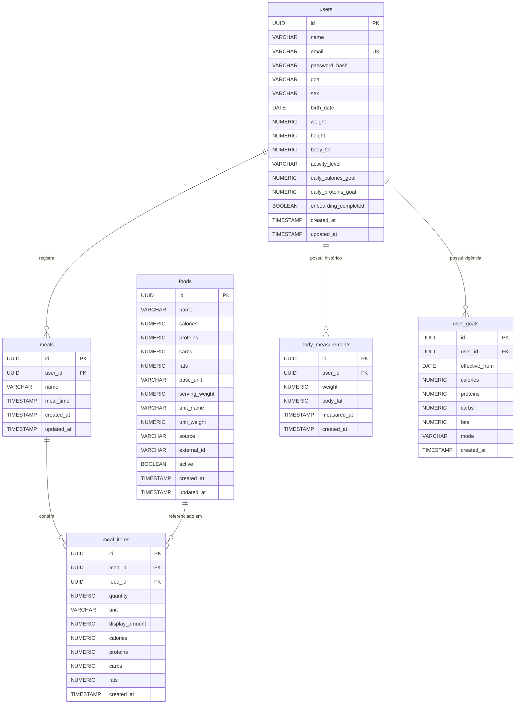

# Arquitetura (ARCHITECTURE.md)

## Visão Geral
O **CalorieSync** adota uma arquitetura Full-stack separada em monorepo com workspaces unificados, utilizando `npm --prefix` no `package.json` da raiz para orquestrar dependências e comandos. Há separação estrita entre o cliente SPA (React 19 + Vite) e o servidor de API REST (Node.js 22+ com Express e TypeScript).

---

## Modelo e Fluxo de Dados

```mermaid
flowchart TD
    A[Usuário/Navegador] -->|Interage| B(React App - Vite)
    B -->|React Query - HTTP/JSON| C{Express API - Backend}
    C -->|Controllers| D[Middlewares - Auth JWT / Zod]
    D -->|Validação OK| E[Services - Regra de Negócio Pura]
    E -->|Models| F[(PostgreSQL)]
    F -.->|Retorna Dados| E
    E -.->|Formata Resposta| C
    C -.->|JSON {success, data, message}| B
```

---

## Modelo de Dados (Diagrama ER Atualizado)

O banco de dados relacional é composto por 6 tabelas principais gerenciadas por migrações versionadas via `node-pg-migrate`:



---

## Módulos e Responsabilidades

### Backend (`/backend`)
- **Controllers (`src/controllers/`):** Tradução HTTP exclusiva: parseamento de parâmetros, chamada dos services correspondentes e formatação da resposta `{ success, data, message }`. Não contém regras de negócio.
- **Services (`src/services/`):** Lógica pura de negócio e orquestração (cálculo de TMB com Mifflin-St Jeor / Katch-McArdle, vigência de metas diárias, totalização nutricional).
- **Models (`src/models/`):** Acesso direto ao PostgreSQL via driver `pg` (Pool), com consultas parametrizadas contra SQL Injection e sem uso de ORMs pesados.
- **Middlewares (`src/middlewares/`):** Autenticação JWT (`auth.ts`), validação estrita com Zod (`validate.ts`) e tratamento global de erros com fail-safe (`errorHandler.ts`).
- **Migrações (`migrations/`):** Scripts SQL puros versionados com `node-pg-migrate`, incluindo índices GIN de busca por similaridade trigram (`pg_trgm`) e função wrapper imutável de acentuação (`f_unaccent`).

### Frontend (`/frontend`)
- **Components (`src/components/`):** Componentização modular baseada em Radix UI e Tailwind CSS, seguindo design brutalista (bordas sólidas, zero cantos arredondados, focus trap em modais).
- **Services & Client (`src/services/`):** Cliente HTTP centralizado (`apiFetch`) com injeção automática de Bearer token e tratamento de sessão expirada.
- **Data Fetching:** TanStack Query (React Query v5) para todas as requisições assíncronas, garantindo cache, revalidação e tratamento obrigatório de estados `loading`, `error`, `empty` e `data`.
- **Validação:** Schemas Zod integrados com formulários.

---

## Decisões Técnicas Relevantes

1. **Zod Full-Stack:** Schemas de validação compartilham formatos conceituais entre frontend e backend para garantir contratos invioláveis.
2. **PostgreSQL Puro (`pg`) + `node-pg-migrate`:** Opção consciente por SQL puro sem Prisma ou Sequelize, permitindo controle preciso de índices, transações e performance.
3. **Estratégia de Testes:**
   - **Backend:** `node:test` + `node:assert` integrado via `tsx --test`. Não requer compiladores externos ou dependências pesadas, executando em banco isolado (`contador_calorias_test`).
   - **Frontend:** `Vitest` + `React Testing Library` + `MSW` (Mock Service Worker), com testes guiados por acessibilidade (`getByRole`, `getByLabelText`).
4. **Histórico com Vigência:** Metas diárias não sobrescrevem dias passados; a tabela `user_goals` associa `(user_id, effective_from)`, permitindo que dias anteriores mantenham a comparação fidedigna com a meta que vigorava na época.
